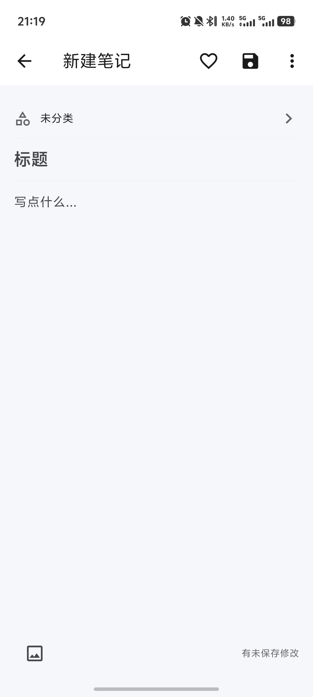
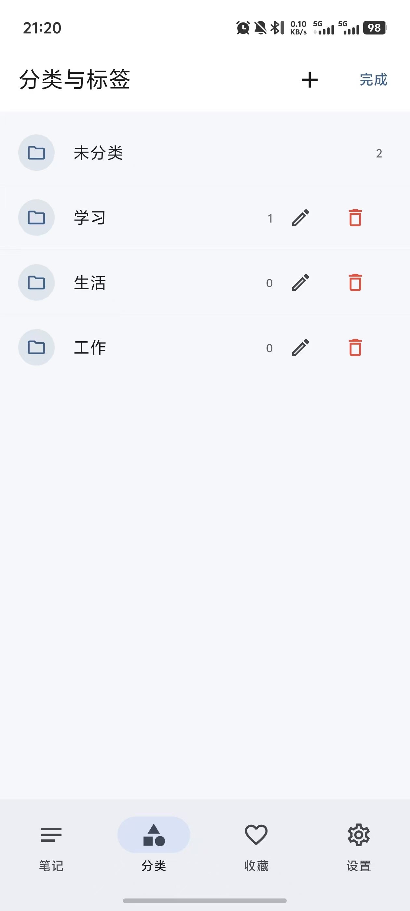
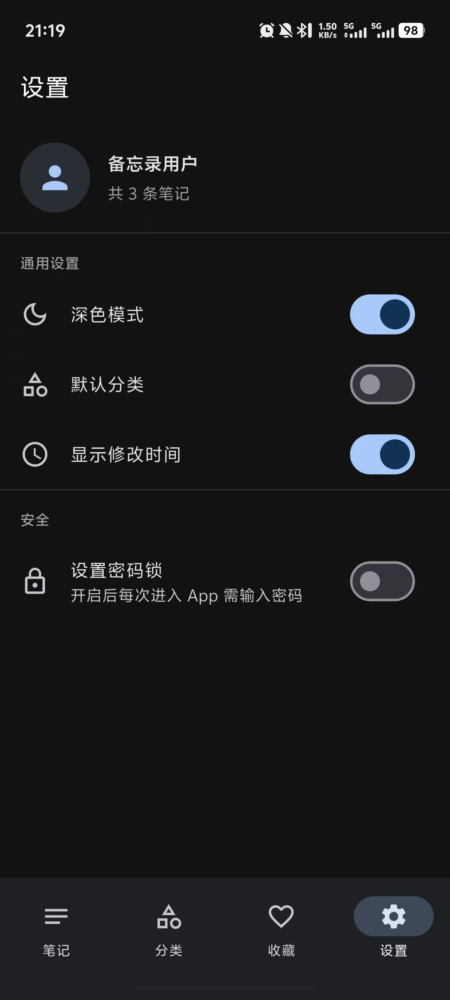
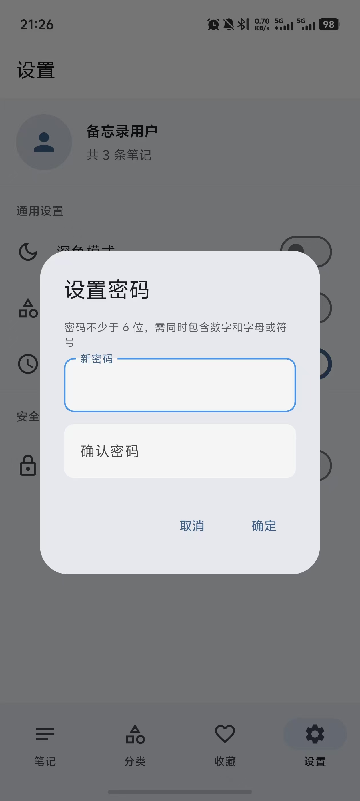
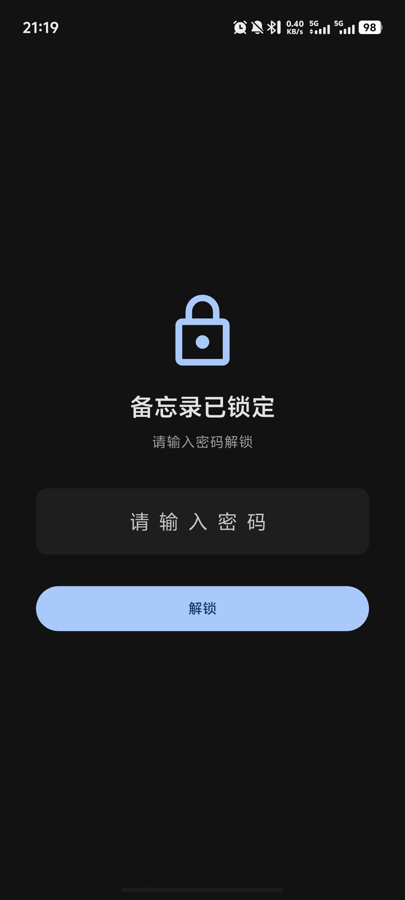

# 备忘录 Memorandum

一个基于 Flutter 开发的 Android 个人备忘录应用，**纯前端、无后端、无网络请求**，所有数据保存在设备本地。

界面简洁，主色调为清爽蓝（蓝 + 白 + 灰），支持深色模式。

---

## 真机演示

以下截图均来自 Android 真机运行效果。

|  |  |  |
| :---: | :---: | :---: |
| **笔记首页**<br/>搜索 / 分类筛选 / 卡片列表 | **新建笔记**<br/>标题 / 正文 / 图片 / 分类 | **分类与标签**<br/>数量统计 / 重命名 / 删除 |
|  |  |  |
| **收藏列表**<br/>单独汇总收藏笔记 | **深色模式**<br/>全局深色主题 | **设置密码**<br/>长度与字符校验 |
|  | | |
| **密码锁**<br/>开启后进入 App 需解锁 | | |

---

## 功能特性

### 笔记

- 新建、编辑、删除笔记，字段包含：标题、正文、所属分类、是否收藏、创建时间、修改时间
- 支持从相册插入图片，图片保存在 App 私有目录，笔记中只记录路径
- 支持一键复制正文到剪贴板
- 首页搜索：同时匹配标题与正文，输入带 300ms 防抖
- 按分类筛选，分类标签可横向滚动
- 长按笔记卡片弹出快捷菜单：收藏 / 取消收藏、删除、添加分类
- 卡片展示分类标签、图片缩略图、完整修改时间（yyyy/MM/dd HH:mm）

### 分类与标签

- 内置「未分类 / 学习 / 生活 / 工作」
- 支持新建、重命名、删除分类，并显示每个分类下的笔记数量
- 删除分类时，其下笔记自动移入「未分类」（由数据库事务保证一致性）
- 编写笔记时可在分类选择弹窗中直接新建分类，创建后自动选中

### 收藏

- 单独展示所有收藏笔记，可取消收藏

### 设置

- 深色模式：全局切换，重启后保持
- 默认分类：开启后新建笔记自动套用
- 显示修改时间：控制卡片是否显示时间
- 密码锁：开启后每次进入 App 需输入密码；从后台返回时同样需要验证
- 密码规则：不少于 6 位，且需同时包含数字和字母或符号

---

## 技术栈

- **Flutter / Dart**：跨平台 UI 与业务逻辑
- **状态管理**：`ChangeNotifier` + `ListenableBuilder`，未引入第三方状态库

### 本地存储方案

| 数据 | 方案 | 说明 |
| --- | --- | --- |
| 笔记、分类 | `sqflite` | 结构化数据，支持条件查询、排序、事务 |
| 设置开关 | `shared_preferences` | 少量键值配置 |
| 密码 | `flutter_secure_storage` | 存入 Android Keystore，不落明文 |
| 笔记图片 | App 私有目录 `note_images/` | 数据库只存文件路径 |

### 数据层设计要点

- 数据库 `memorandum.db`，包含 `notes`、`categories` 两张表，带 `version` 与 `onUpgrade` 升级入口
- 搜索使用参数化查询（`LIKE ?` + `whereArgs`），避免 SQL 注入
- 删除分类使用事务：先把笔记迁移到「未分类」，再删除分类，保证原子性
- 删除笔记、放弃编辑、替换图片时自动清理孤儿图片文件

---

## 项目结构

```
lib/
├── main.dart                 # 应用入口、主题与锁屏覆盖层
├── models/                   # 数据模型
│   ├── note.dart
│   └── category.dart
├── pages/
│   ├── home_page.dart        # 底部导航容器
│   ├── lock_page.dart        # 密码锁屏
│   ├── notes/
│   │   ├── notes_page.dart       # 笔记首页
│   │   └── note_edit_page.dart   # 新建 / 编辑笔记
│   ├── categories/
│   │   └── categories_page.dart  # 分类与标签
│   ├── favorites/
│   │   └── favorites_page.dart   # 收藏列表
│   └── settings/
│       └── settings_page.dart    # 设置
├── services/
│   ├── database_helper.dart  # sqflite 单例与 CRUD
│   ├── settings_service.dart # 设置项读写
│   └── password_service.dart # 密码校验与安全存储
├── state/                    # 全局状态（主题、导航刷新）
├── theme/                    # 主题配色
├── utils/                    # 日期格式化、图片存储
└── widgets/                  # 笔记卡片等复用组件
```

---

## 运行

### 环境要求

- Flutter SDK（Dart 3）
- Android SDK，一台 Android 设备或模拟器

### 调试运行

```bash
flutter pub get
flutter run
```

> 提示：本项目依赖 `sqflite` 等原生插件，请在 **Android 设备 / 模拟器** 上运行，不要选择 Chrome / Web。

### 打包安装

```bash
flutter build apk --release
```

产物位于 `build/app/outputs/flutter-apk/app-release.apk`。

---

## 说明

- 本项目为纯本地应用，不包含任何账号体系、云同步或网络接口
- 卸载 App 会同时清除本地笔记、分类、图片与设置
